<div align="center">

<!-- Animated Header Banner -->


<!-- Typing SVG -->
<a href="https://git.io/typing-svg">
  
</a>

<br/>

<!-- Profile Shields -->
<p>
  
  &nbsp;
  
  &nbsp;
  
</p>

</div>

---

<!-- About Me Section -->


## 🌌 About Me — The DevOps Universe's Finest

```yaml
name: Atul V Singh
role: DevOps & DevSecOps Engineer
location: India 🇮🇳
mission: "Automate Everything. Secure Everything. Scale Everything."

philosophy:
  - "Security is not a feature. It's a culture."
  - "Infrastructure as Code isn't optional, it's the law."
  - "If it's not monitored, it doesn't exist."

currently:
  - 🔭 Building zero-trust, cloud-native security pipelines
  - 🌱 Mastering eBPF, SLSA & Supply Chain Security
  - 🛡️  Implementing SAST/DAST/SCA at enterprise scale
  - ⚡ Automating everything that breathes

interests:
  - Cloud Architecture & Multi-Cloud Strategy
  - Container Security & Runtime Protection
  - Shift-Left Security & GitOps
  - SRE & Platform Engineering
```

<br clear="right"/>

---

## 🔥 My Tech Arsenal — The Full Stack of Destruction

<div align="center">

### ☁️ Cloud Platforms
<p>
  
  
  
</p>


### 🔄 CI/CD & GitOps
<p>
  
  
  
</p>

### 🏗️ Infrastructure as Code
<p>
  
  
  
</p>


### 📊 Observability & Monitoring
<p>
  
  
  
  
  
</p>

### 💻 Languages & Scripting
<p>
  
  
  
  
  
</p>

</div>

---

## 🏆 Achievements & Certifications

<div align="center">

| 🎖️ Certification | 🏢 Issuer | ✅ Status |
|:---|:---|:---|
| AWS Certified DevOps Engineer – Professional | Amazon Web Services | ✅ Certified |
| Certified Kubernetes Administrator (CKA) | CNCF | ✅ Certified |
| Certified Kubernetes Security Specialist (CKS) | CNCF | ✅ Certified |
| HashiCorp Certified: Terraform Associate | HashiCorp | ✅ Certified |
| Microsoft Azure DevOps Engineer Expert | Microsoft | ✅ Certified |
| Certified Cloud Security Professional (CCSP) | (ISC)² | 🔄 In Progress |

</div>

---

## 📊 GitHub Statistics — The Numbers Don't Lie

<div align="center">


<br/>


<br/>

<!-- GitHub Contribution Snake -->
<picture>
  <source media="(prefers-color-scheme: dark)" srcset="https://raw.githubusercontent.com/atul-v-singh-tech/atul-v-singh-tech/output/github-contribution-grid-snake-dark.svg"/>
  <source media="(prefers-color-scheme: light)" srcset="https://raw.githubusercontent.com/atul-v-singh-tech/atul-v-singh-tech/output/github-contribution-grid-snake.svg"/>
  
</picture>

</div>

---

## 🎯 DevSecOps Philosophy — My North Star

<div align="center">

```
╔══════════════════════════════════════════════════════════════════╗
║                                                                  ║
║   "In a world where breaches are inevitable,                     ║
║    the distance between detection and response                   ║
║    is the only thing that matters."                              ║
║                                                                  ║
║                                    — Atul V Singh                ║
║                                                                  ║
╚══════════════════════════════════════════════════════════════════╝
```

</div>

### 🔐 My DevSecOps Pipeline Mantra

```mermaid
graph LR
    A[💻 Code] -->|SAST + Secrets Scan| B[🔍 Scan]
    B -->|SCA + License Check| C[🏗️ Build]
    C -->|Container Scan + SBOM| D[📦 Package]
    D -->|DAST + Pen Test| E[🧪 Test]
    E -->|Policy as Code + OPA| F[🚀 Deploy]
    F -->|Runtime Security + CSPM| G[📊 Monitor]
    G -->|SIEM + Threat Intel| A

    style A fill:#1a1a2e,color:#00d4ff,stroke:#00d4ff
    style B fill:#1a1a2e,color:#ff6b6b,stroke:#ff6b6b
    style C fill:#1a1a2e,color:#ffd93d,stroke:#ffd93d
    style D fill:#1a1a2e,color:#6bcb77,stroke:#6bcb77
    style E fill:#1a1a2e,color:#4d96ff,stroke:#4d96ff
    style F fill:#1a1a2e,color:#ff922b,stroke:#ff922b
    style G fill:#1a1a2e,color:#cc5de8,stroke:#cc5de8
```



---

## 📝 Latest Blog Posts & Writing

<!-- BLOG-POST-LIST:START -->
> 🔐 **Zero Trust Architecture in Kubernetes: A Practical Guide**
>
> 🚀 **GitOps at Scale: Managing 100+ Microservices with ArgoCD**
>
> 🛡️ **Supply Chain Security: From SBOM to SLSA Level 4**
>
> ☁️ **Cost Optimization in Multi-Cloud Environments: Real Strategies**
<!-- BLOG-POST-LIST:END -->

---

## 📈 Contribution Activity

<div align="center">


</div>

---

## 🤝 Let's Connect & Build Together

<div align="center">

<p>
  <a href="https://linkedin.com/in/atul-v-singh" target="_blank">
    
  </a>
  &nbsp;
  <a href="https://twitter.com/atul_v_singh" target="_blank">
    
  </a>
  &nbsp;
  <a href="mailto:singhatulvivek@gmail.com" target="_blank">
    
  </a>
</p>

<p>
  <a href="https://dev.to/atul-v-singh" target="_blank">
    
  </a>
  &nbsp;
  <a href="https://medium.com/@atul-v-singh" target="_blank">
    
  </a>
  &nbsp;
  <a href="https://hub.docker.com/u/atulvsingh" target="_blank">
    
  </a>
</p>

<br/>

### 💬 Ask Me About
`DevSecOps` &nbsp;·&nbsp; `Kubernetes Security` &nbsp;·&nbsp; `CI/CD Pipeline Design` &nbsp;·&nbsp; `Cloud Architecture` &nbsp;·&nbsp; `Zero Trust` &nbsp;·&nbsp; `eBPF` &nbsp;·&nbsp; `Supply Chain Security` &nbsp;·&nbsp; `SRE Best Practices`

<br/>

<!-- Footer Banner -->


<p>
  
  &nbsp;&nbsp;
  
</p>

</div>
